# CAUSAL-X

### Financial Decision Intelligence & Causal Impact Optimization

> **Predict outcomes. Estimate impact. Optimize decisions.**

     

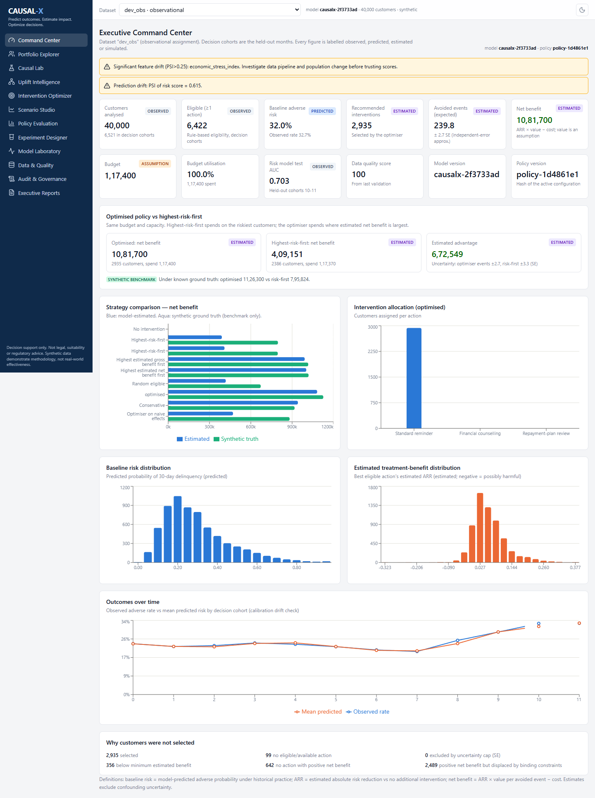

CAUSAL-X is a local, end-to-end decision-support platform for a lender that must decide **which customer should receive which repayment intervention** (a reminder, financial counselling, or a repayment-plan review) with a **limited budget and a limited number of agents**.

A normal risk model says *who is likely to miss a payment*. It does not say *who an intervention would actually help*. CAUSAL-X estimates how much each action changes each customer's outcome, quantifies how much to trust that estimate, and then chooses the best allocation under real constraints.

> **Status:** a working, tested system on **synthetic data**. It demonstrates a methodology. It is **not** production software and **not** evidence that these interventions work on real customers.

---

## Table of contents

1. [The problem](#1-the-problem)
2. [How it works (workflow)](#2-how-it-works-workflow)
3. [Product tour](#3-product-tour)
4. [What the experiments show](#4-what-the-experiments-show)
5. [Key features](#5-key-features)
6. [Architecture](#6-architecture)
7. [Technology stack](#7-technology-stack)
8. [Installation and running](#8-installation-and-running)
9. [Configuration](#9-configuration)
10. [Methodology](#10-methodology)
11. [Synthetic data](#11-synthetic-data)
12. [Database and storage](#12-database-and-storage)
13. [API](#13-api)
14. [Testing and benchmarks](#14-testing-and-benchmarks)
15. [Governance and ethics](#15-governance-and-ethics)
16. [Known limitations](#16-known-limitations)
17. [Future work](#17-future-work)
18. [Project structure](#18-project-structure)
19. [Documentation index](#19-documentation-index)
20. [License](#20-license)

---

## 1. The problem

A bank has many customers with loans. Some are at risk of missing payments. The bank can intervene, but each action costs money and some need a trained agent:

| Action | Cost (default, editable) | Resource |
|---|---|---|
| Standard reminder | 40 | automated channel |
| Financial counselling | 250 | agent (1.0 slot) |
| Repayment-plan review | 500 | agent (1.5 slots) |
| No additional intervention | 0 | none |

Why "call the riskiest customers first" is not enough:

* Some customers will repay **regardless** of contact. Contacting them wastes money.
* Some will default **even after** contact.
* Some **respond** well, and that is where money should go.
* Some are **burdened** by the wrong action (for example a plan review for someone not in trouble).

Worse, historical data is *confounded*: lenders contact riskier customers, so a naive comparison of contacted vs. not-contacted customers makes reminders look **harmful**. CAUSAL-X is built around avoiding exactly this mistake.

## 2. How it works (workflow)

```mermaid
flowchart LR
  A[1 Data<br/>generate or upload] --> B[2 Validate<br/>quality, leakage, time order]
  B --> C[3 Predict risk<br/>who is likely late]
  C --> D[4 Estimate effects<br/>what does each action change]
  D --> E[5 Who benefits<br/>uplift + uncertainty]
  E --> F[6 Optimize<br/>best action per customer<br/>under budget and capacity]
  F --> G[7 What-if<br/>scenarios, stress tests]
  G --> H[8 Human review<br/>explain, approve, override]
  H --> I[9 Monitor + report]
```

| Step | Plain-language question | Module | Dashboard page |
|---|---|---|---|
| 1-2 | Is the data trustworthy? | `data/` | Data & Quality |
| 3 | Who is likely to be late in 30 days? | `predictive/` | Model Laboratory |
| 4 | What would a reminder change *on average*, and can we trust that number? | `causal/` | Causal Lab |
| 5 | For *whom* does it change the outcome? | `uplift/` | Uplift Intelligence |
| 6 | Which action for whom, within budget? | `optimization/` | Intervention Optimizer |
| 7 | What if budget, cost, effect or economy change? | `simulation/`, `policy_evaluation/` | Scenario Studio, Policy Evaluation |
| 8-9 | Can a person review it, and is it still working? | `governance/`, `monitoring/`, `reporting/` | Audit & Governance, Reports |

## 3. Product tour

### Portfolio Explorer and decision explanation

Search and filter customers (loan type, risk band, response segment, eligibility, uncertainty, region, cohort). Click any row for a full explanation.

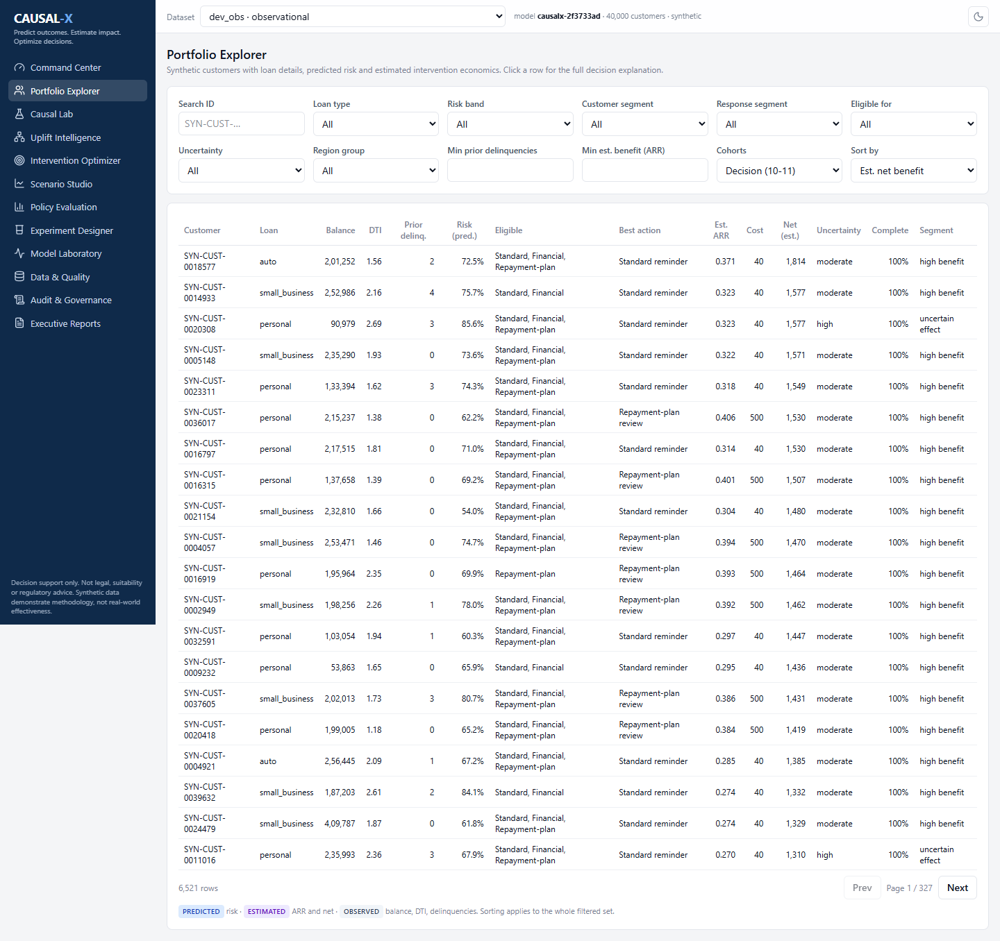

The explanation separates three things that are often mixed up: the **predictive** explanation (SHAP drivers of the risk score), the **causal** estimate (effect of each action with an interval and its assumptions), and the **optimisation** logic (cost, break-even benefit, why an alternative was not chosen, whether human review is required).

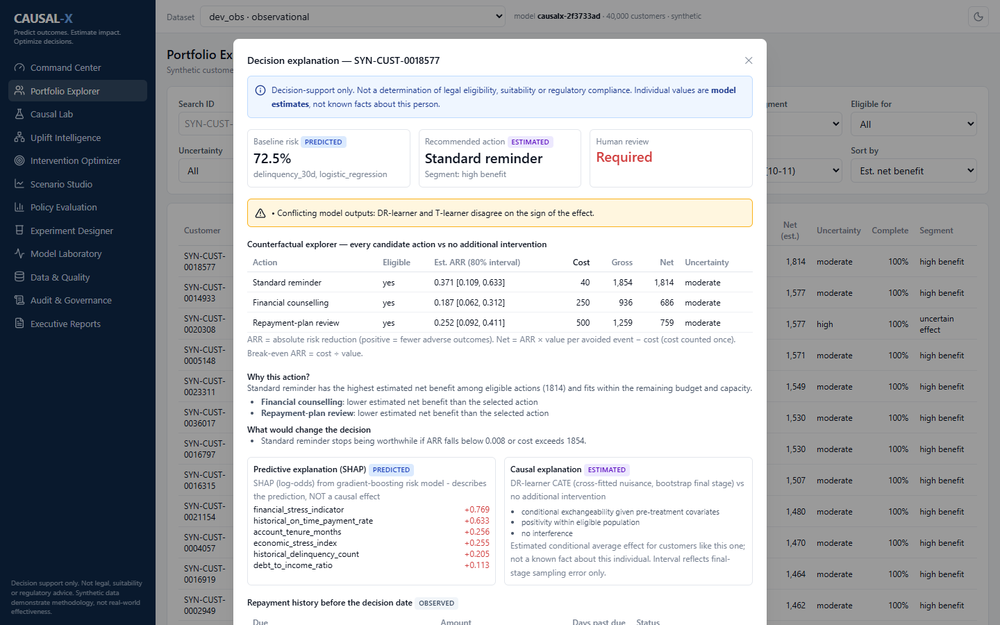

### Causal Lab

Define the causal question, pick an estimator, and inspect the evidence: estimate with interval, estimator comparison, covariate balance (Love plot), propensity overlap, effective sample size, a plain-language "can this be read causally?" verdict, and a sensitivity analysis (placebo outcome, E-value, alternative specifications).

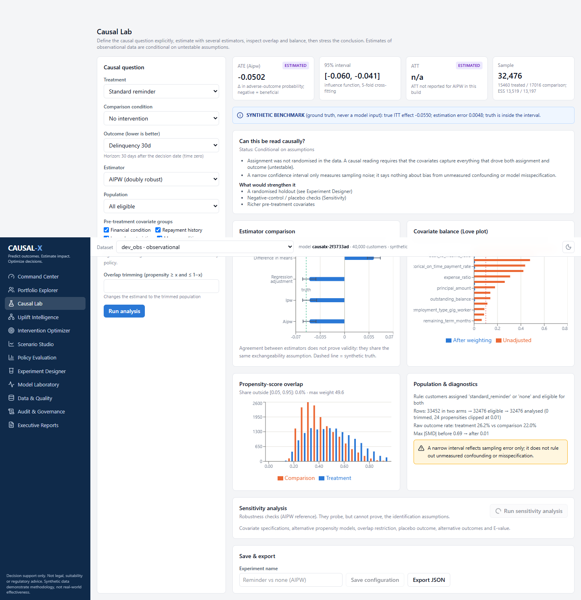

### Uplift Intelligence

Baseline risk vs. estimated benefit, response segments (click a bar to open those customers in the portfolio), Qini curves comparing the effect model with a plain risk ranking, and calibration of predicted vs. realised benefit.

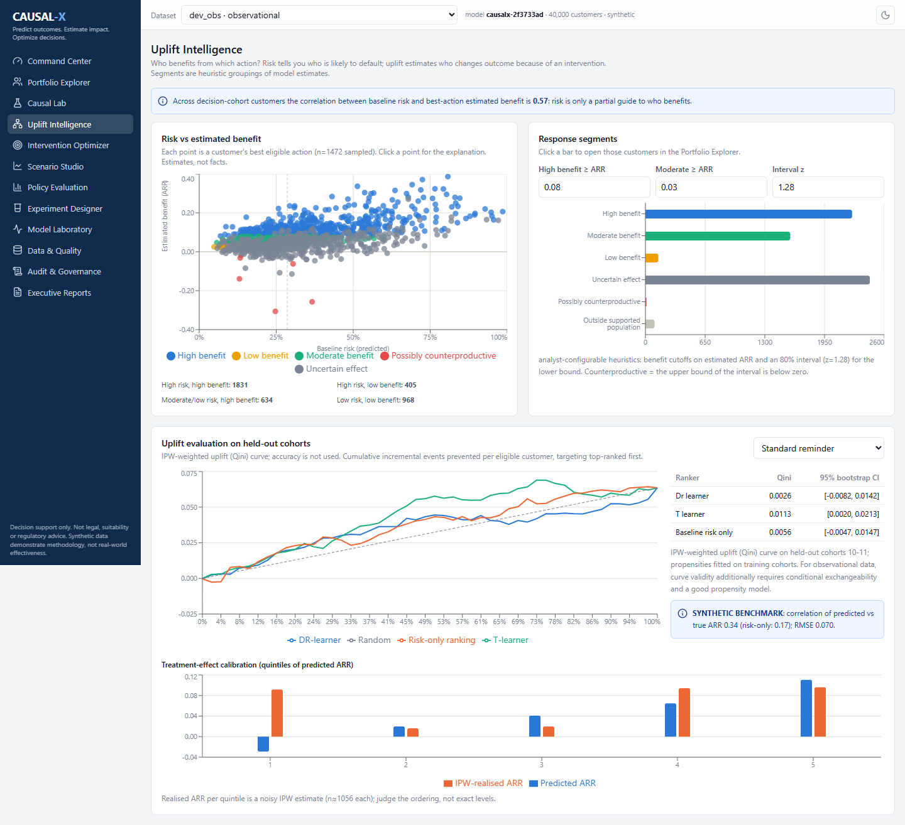

### Intervention Optimizer

Set budget, agent and channel capacity, per-action caps, costs, minimum benefit, uncertainty cap, conservatism and coverage requirements. The result shows the allocation, binding constraints, shadow prices, exclusion reasons, a fairness table, and a comparison with eight alternative strategies.

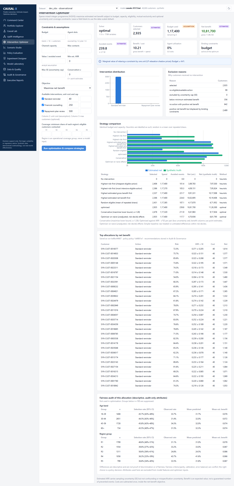

### Scenario Studio

Ten scenarios (budget cut or expansion, economic deterioration, higher costs, weaker effects, limited agents, unreliable-effect exclusion, an unavailable action, a conservative objective), Monte Carlo uncertainty, budget and capacity frontiers, stress tests, the optimiser's-curse check and a value-of-information upper bound.

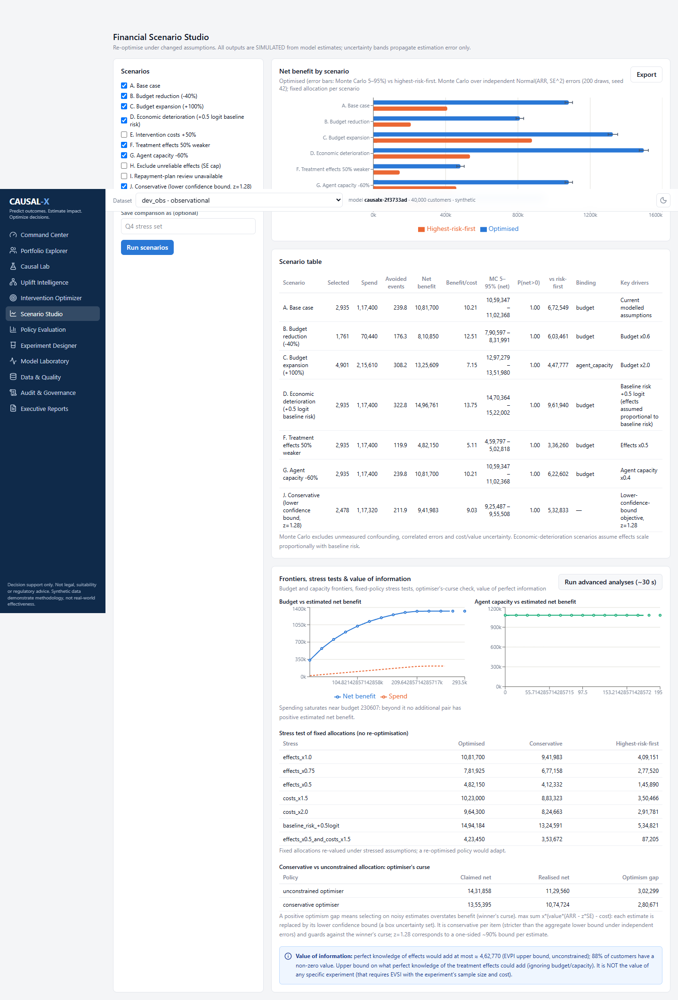

### Policy Evaluation

How would each policy have performed on cohorts no model was trained on? Doubly robust off-policy estimates with intervals, shown next to the model's own estimate and (for synthetic data) the known truth.

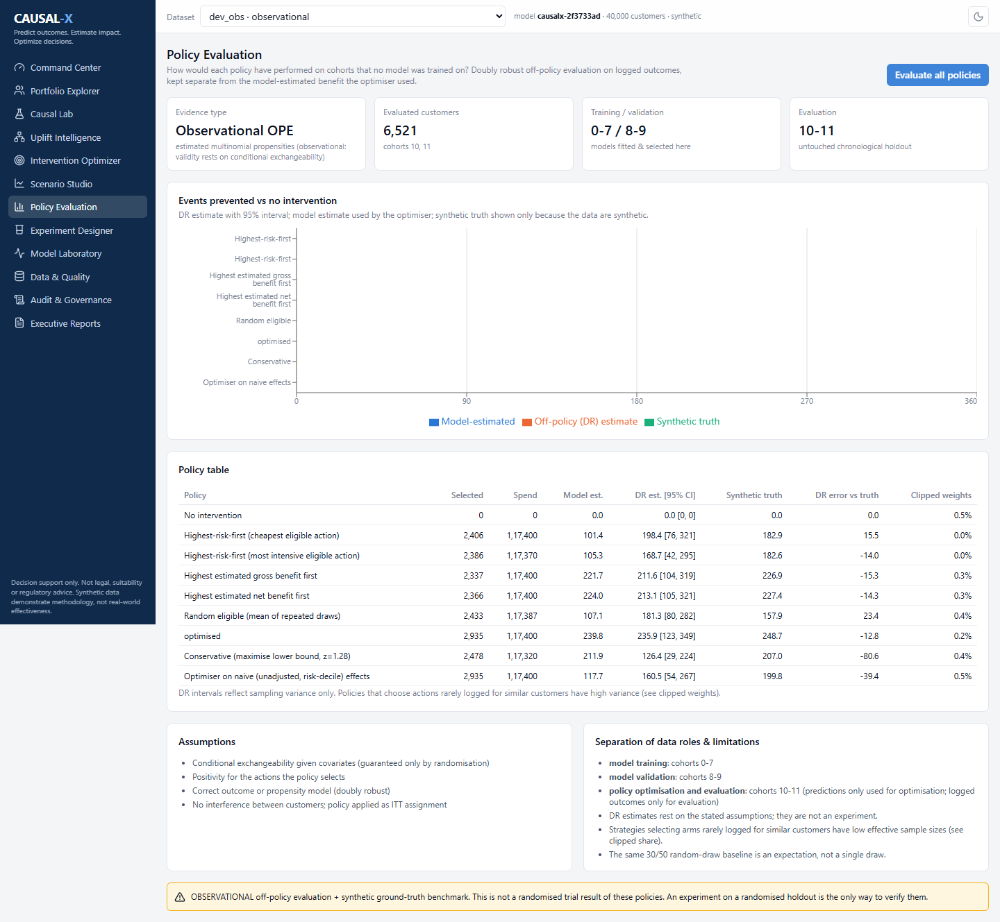

### Experiment Designer

Sample sizes for binary and continuous outcomes with attrition, non-compliance, clustering and multiple-comparison adjustments, and an exportable protocol that is always stamped *draft, not approved*.

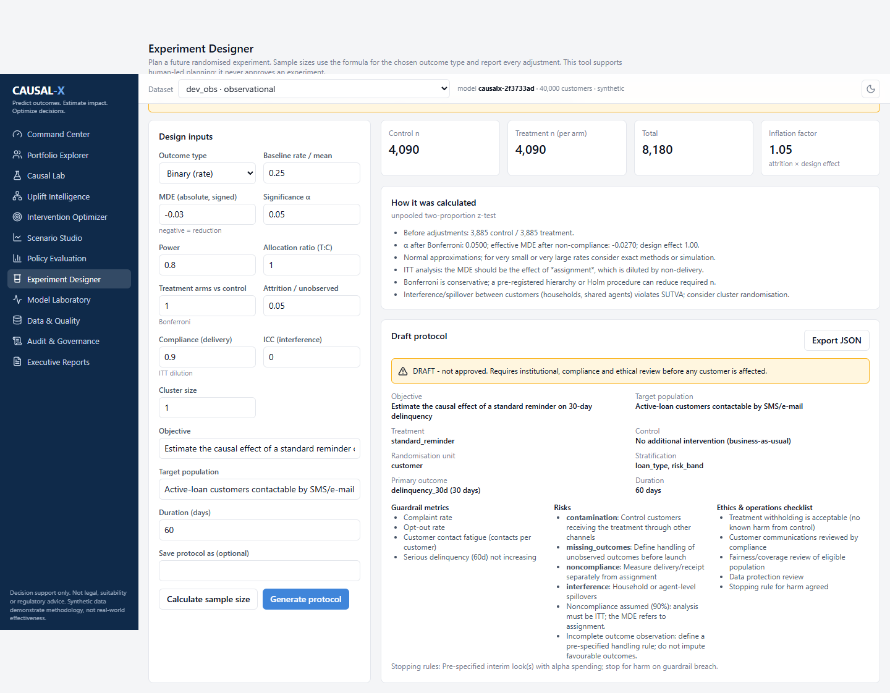

### Model Laboratory

Model comparison by Brier, ROC-AUC, PR-AUC, precision, recall, F1 and expected cost, calibration, SHAP importance, feature groups and the registry. Predictive metrics and treatment-effect metrics are kept apart on purpose.

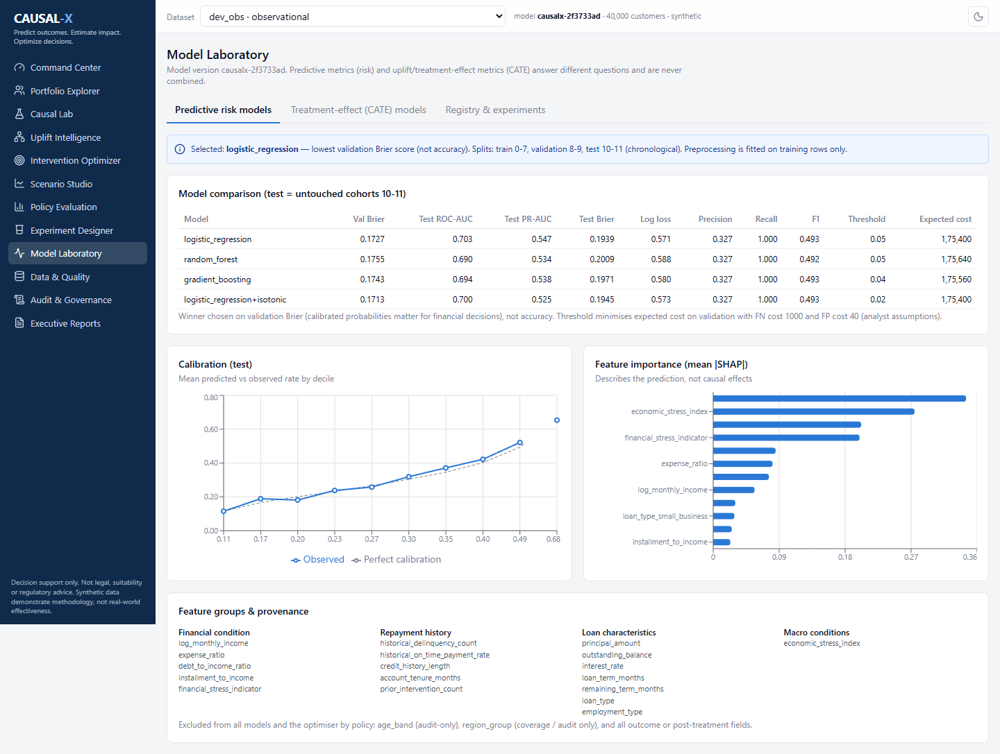

### Data & Quality

Generate datasets (size and scenario), train models as a background job with progress, upload a CSV with column mapping, and read validation reports with exact row-exclusion counts and a "which analyses are supported" table.

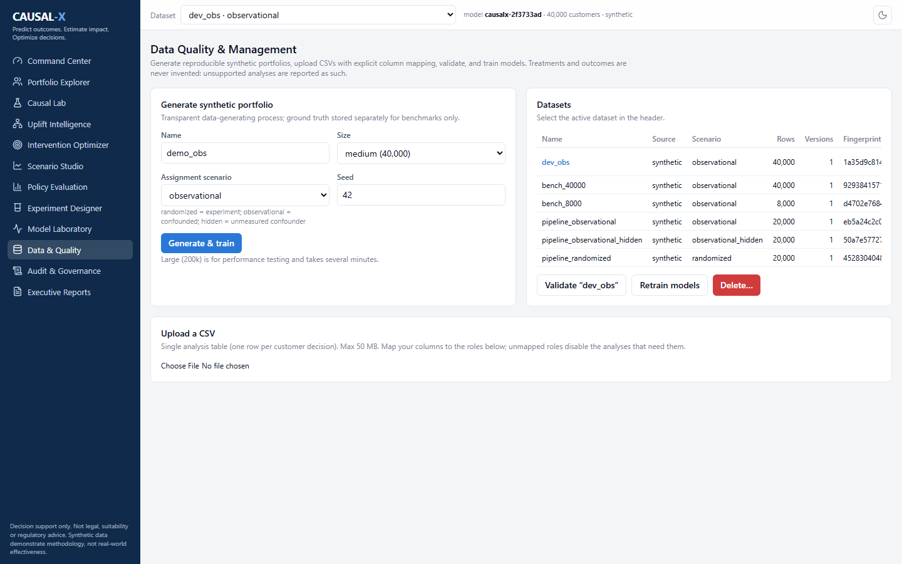

### Audit & Governance and Monitoring

Every recommendation is stored with its model, policy and data versions and its explanation. Reviewers approve, reject or override (to an eligible action only, with a reason); the original recommendation is always preserved. Monitoring shows feature drift (PSI/KS), calibration by cohort, treatment mix and effect stability.

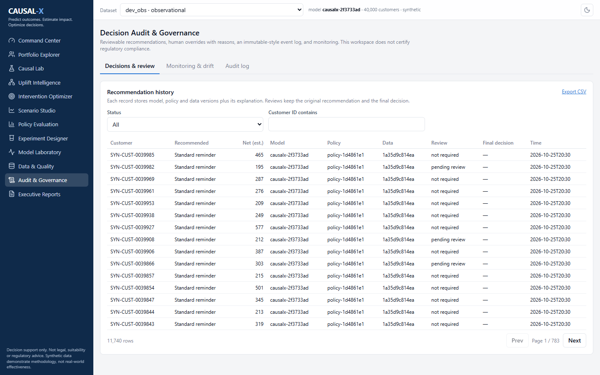

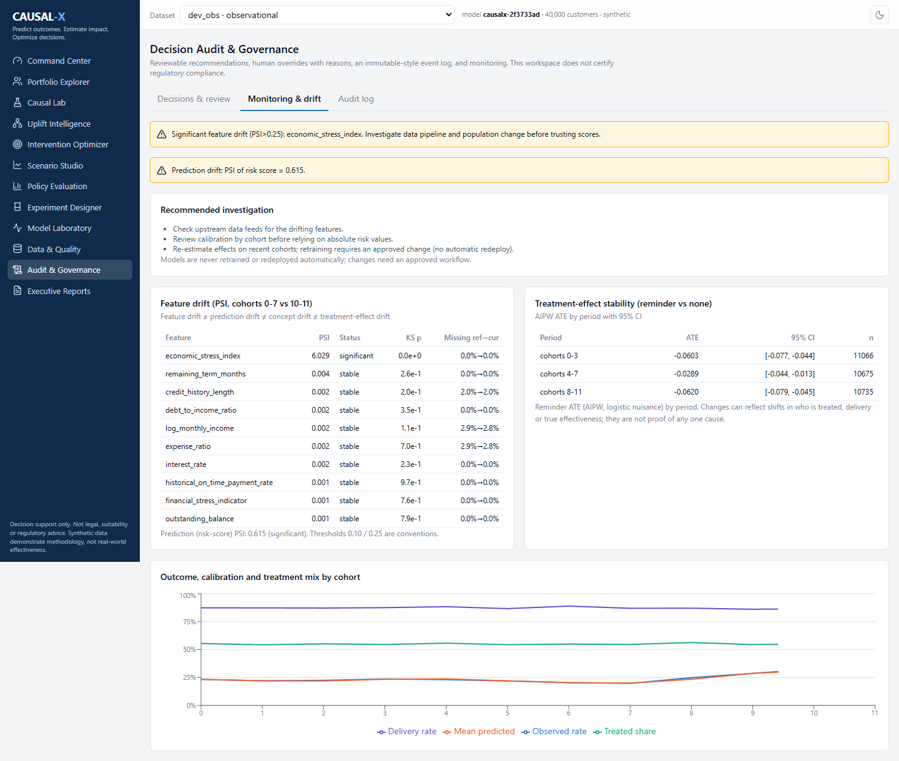

The twelfth page, **Executive Reports**, generates a Markdown, HTML and PDF report from the executed results.

## 4. What the experiments show

All numbers below come from `python scripts/run_demo_pipeline.py --n 20000` (seed 42, synthetic data, full table in `docs/model_card.md`). "Truth" is the generator's known effect, available only because the data are synthetic.

### Average effect of a standard reminder on 30-day delinquency (negative = fewer late customers)

| Assignment scenario | Truth | Raw treated-vs-untreated gap | Regression | IPW | AIPW (95% CI) |
|---|---|---|---|---|---|
| Randomised | -0.054 | -0.059 | -0.056 | -0.056 | -0.056 [-0.069, -0.042] |
| Confounded (observed) | -0.054 | **+0.041** (wrong sign) | -0.051 | -0.051 | -0.051 [-0.064, -0.037] |
| Confounded by a hidden factor | -0.054 | **+0.061** (wrong sign) | -0.017 | -0.015 | **-0.016** [-0.029, -0.002] (wrong) |

1. With **randomisation**, every estimator recovers the truth.
2. With **observed confounding**, the naive comparison has the wrong *sign*; adjustment fixes it.
3. With a **hidden confounder**, adjustment cannot fix it, but the tool says so: the placebo outcome test fires, the sensitivity spread is flagged unstable, and an E-value is reported.

### Policy comparison (net benefit, same budget and capacity, confounded scenario, 20,000 customers)

| Strategy | Model-estimated | Synthetic truth |
|---|---|---|
| No intervention | 0 | 0 |
| Random eligible (mean of draws) | 247,225 | 318,609 |
| Highest-risk-first (cheapest action) | 272,847 | 360,469 |
| Highest-risk-first (most intensive action) | 278,269 | 374,377 |
| Optimiser fed naive (unadjusted) effects | 283,606 | 324,922 |
| Highest net benefit first (greedy) | 581,444 | 488,549 |
| Conservative optimiser (lower bound, z = 1.28) | 533,645 | 479,589 |
| **Optimised (MILP)** | **629,070** | **551,219** |

The optimiser beats "highest-risk-first" by roughly 50% in truth terms. Feeding it naive, unadjusted effects destroys most of that gain.

### Honest caveats from the same runs

* **Optimiser's curse:** in the randomised run the model-estimated net benefit of the optimised policy (about 960k) was roughly 1.8x the truth (about 525k). It still ranked first, but headline numbers are estimates. The conservative objective and larger samples shrink the gap.
* **Risk is not always a bad guide:** for counselling and repayment plans a plain risk ranking is competitive with the effect model (true benefit correlates about 0.6 with baseline risk). The clearest "risk is not benefit" case is the reminder (correlation about 0.17).
* **Off-policy evaluation fails under hidden confounding:** the optimised policy's estimate was -9.7 events prevented vs. truth +114.5.

## 5. Key features

* **Synthetic portfolio generator** with an explicit causal data-generating process, three assignment regimes, and a *separate* ground-truth table used only for benchmarks.
* **Causal engine:** difference in means, regression adjustment, IPW (Hajek), cross-fitted AIPW; balance (SMD/Love), overlap, effective sample size and weight diagnostics; sensitivity analysis (covariate sets, propensity models, trimming, placebo outcome, alternative outcomes, E-value). Fewer than 30 units per arm returns `insufficient_evidence` instead of a number.
* **Uplift:** cross-fitted DR-learner CATE with bootstrap uncertainty, T-learner comparison, Qini/AUUC with bootstrap CIs, calibration by quintile, configurable response segments.
* **Optimizer:** sparse mixed-integer programme (HiGHS) with budget, agent and channel capacity, per-action caps, eligibility, mutual exclusivity, minimum benefit, uncertainty cap, regional coverage minima, three objectives, shadow prices, honest infeasibility reporting.
* **Reliability tooling:** conservative objective, optimiser's-curse simulation, budget/capacity frontiers, stress tests, Monte Carlo propagation, value-of-information upper bound, off-policy policy evaluation vs. ground truth.
* **Governance:** recorded eligibility rules, stored explanations, human review with reasons, original-vs-final decision, audit log, model/policy/data versioning, drift monitoring, fairness audit with small-group suppression.
* **Data management:** CSV upload with column mapping, validation, leakage warnings, explicit exclusion counts and a capability matrix. It never invents missing treatments or outcomes.
* **Experiment designer** and an **analyst assistant** that only *proposes* a configuration from a plain-language question.
* **12-page React dashboard** with light/dark theme, loading/empty/error states and provenance tags (observed / predicted / estimated / simulated / assumption / synthetic) on every number.

## 6. Architecture

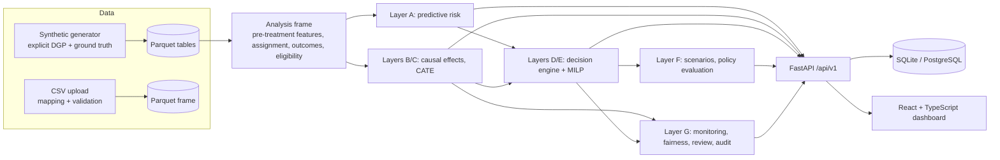

Data roles are kept strictly apart to avoid leakage:

| Role | Cohorts (months) | Used for |
|---|---|---|
| Training | 0-7 | risk model, effect models, nuisance models |
| Validation | 8-9 | model selection (Brier), threshold, calibration choice |
| Decision / final evaluation | 10-11 | metrics, uplift evaluation, optimisation, policy evaluation |

Full decision record and a scored brainstorm of 20 additional ideas: [`docs/architecture.md`](docs/architecture.md).

## 7. Technology stack

| Area | Tools |
|---|---|
| Backend | Python 3.12, FastAPI, Pydantic 2, SQLAlchemy 2 |
| Data and ML | pandas, NumPy, SciPy (HiGHS MILP), scikit-learn, LightGBM, SHAP, PyArrow |
| Reporting | ReportLab (PDF), Markdown, HTML |
| Frontend | React 19, TypeScript, Vite, Tailwind CSS 4, Recharts, lucide-react |
| Testing | pytest, vitest, Testing Library, Playwright (screenshots) |
| Storage | Parquet (analytic tables), SQLite by default or PostgreSQL (results, audit) |

Deviations from a typical stack, and why: EconML, DoWhy, CVXPY, MLflow, Alembic and shadcn/ui were deliberately **not** used (heavy or version-sensitive dependencies that hide details this product wants visible). See [`docs/architecture.md`](docs/architecture.md).

## 8. Installation and running

Requirements: Python 3.11+ (tested on 3.12), Node 20+ (tested on 24). No Docker, PostgreSQL or paid service is required.

```bash
# 1. backend
python -m venv .venv
source .venv/bin/activate            # Windows: .venv\Scripts\activate
pip install -r backend/requirements.txt
cp .env.example .env                 # optional; defaults work

# 2. demo data + trained models (deterministic, seed 42, ~1.5 min for 40,000 customers)
python scripts/generate_demo_data.py --name demo_obs --size medium --scenario observational --seed 42 --train

# 3. API  ->  http://localhost:8000/docs
cd backend && python -m uvicorn app.main:app --port 8000

# 4. dashboard  ->  http://localhost:5173   (second terminal)
cd frontend && npm install && npm run dev
```

* If port 8000 or 5173 is busy, run the API elsewhere and point the dev server at it: `VITE_API_TARGET=http://127.0.0.1:8010 npx vite --port 5180`.
* `make setup | data | api | web | test | demo | bench` wrap the same commands.
* You can also generate data and train from the UI: **Data & Quality -> Generate & train**.
* Docker files exist (`docker-compose.yml`) but were **never executed** (Docker was unavailable when building).

### Useful scripts

| Script | Purpose |
|---|---|
| `scripts/generate_demo_data.py` | regenerate a dataset deterministically (`--size small|medium|large`, `--scenario`, `--train`) |
| `scripts/validate_dataset.py <name>` | schema, integrity, time-order and leakage checks (non-zero exit on errors) |
| `scripts/run_demo_pipeline.py` | run all three scenarios end to end and print truth vs. estimates |
| `scripts/benchmark.py` | time each stage on chosen dataset sizes |
| `scripts/capture_screenshots.py` | regenerate the images in `docs/screenshots/` from a running app |

### Example workflow in the dashboard

1. **Data & Quality:** generate an observational dataset and a randomised one; validate (score 100).
2. **Causal Lab:** reminder vs. none. Compare the raw gap (+0.041, wrong sign) with AIPW (-0.051); run sensitivity.
3. **Uplift Intelligence:** read the risk-vs-benefit scatter; click a segment to open those customers.
4. **Intervention Optimizer:** set the budget and agents; run; compare with highest-risk-first.
5. **Scenario Studio:** run scenarios, then the advanced analyses.
6. **Policy Evaluation:** check the policies on held-out cohorts against the ground truth.
7. **Audit & Governance:** review a recommendation, override with a reason, export CSV.
8. **Executive Reports:** generate the report.

## 9. Configuration

Set in `.env` (see `.env.example`); nothing secret is stored in source.

| Variable | Default | Meaning |
|---|---|---|
| `CAUSALX_DATABASE_URL` | `sqlite:///data/causalx.db` | any SQLAlchemy URL (PostgreSQL path is untested) |
| `CAUSALX_DATA_DIR` | `./data` | datasets and uploads |
| `CAUSALX_ARTIFACTS_DIR` | `./artifacts` | models, reports, experiment results |
| `CAUSALX_N_CUSTOMERS` | `40000` | default dataset size (presets: small 8k, medium 40k, large 200k) |
| `CAUSALX_SEED` | `42` | analysis seed |
| `CAUSALX_MAX_UPLOAD_MB` | `50` | upload limit |
| `CAUSALX_CORS_ORIGINS` | localhost dev origins | allowed browser origins |

## 10. Methodology

**Notation.** `Y(a)` is the 30-day adverse outcome (1 = delinquent) if a customer receives action `a`. The effect of an action versus no intervention is

```
tau = E[ Y(action) - Y(none) ]        negative = fewer late customers
ARR = -tau                             absolute risk reduction, positive = beneficial
```

Everywhere in the product, charts and tables use this one sign convention. The estimand is an **intention-to-treat effect of assignment** (delivery is imperfect). An individual's effect is never observed, so per-customer numbers are always shown as *estimates with intervals*.

**AIPW (default average-effect estimator).**

```
psi_i = mu1(x_i) - mu0(x_i) + T_i (Y_i - mu1(x_i)) / e(x_i) - (1 - T_i)(Y_i - mu0(x_i)) / (1 - e(x_i))
tau_hat = mean(psi_i)           SE from the influence function, 5-fold cross-fitting
```

It is *doubly robust* (right if either the outcome or the propensity model is right) but **not** robust to unmeasured confounding.

**Heterogeneous effects (DR-learner).** Regress `psi_i` on `x_i` with a shallow, regularised boosted model; uncertainty by bootstrapping that final stage.

**Optimisation.**

```
maximise   sum over (i, a):  x[i,a] * ( V * (ARR[i,a] - z * SE[i,a]) - cost[a] )
subject to one action per customer, total budget, agent capacity, channel capacity,
           per-action caps, regional coverage minima, eligibility and filters
```

`V` is an analyst-set value per avoided event; costs are subtracted exactly once. `z > 0` gives the **conservative** policy: every estimate is replaced by its lower confidence bound, which guards against the optimiser's tendency to pick the luckiest noisy estimates.

**Sensitivity analysis.** Covariate sets, propensity models, overlap trimming, a *placebo outcome* (a pre-treatment variable the treatment cannot change), alternative outcome definitions, and the E-value. These probe robustness; they cannot prove the absence of confounding.

**Evidence classes**

| Class | Meaning here |
|---|---|
| Synthetic benchmark | Known generator effects; checks code and method behaviour. Labelled in the UI. |
| Observational estimate | Adjusted from logged assignment; conditional on exchangeability. |
| Randomised experimental evidence | **None in this repository.** The Experiment Designer plans how to get it. |

Deeper write-ups: [`causal_methodology`](docs/causal_methodology.md), [`optimization_methodology`](docs/optimization_methodology.md), [`experiment_design`](docs/experiment_design.md).

## 11. Synthetic data

IDs are synthetic (`SYN-CUST-0000001`); no personal data exist. Each customer has latent traits (financial stress, forgetfulness, an income shock) that drive the baseline risk and how they respond:

| Action | Who it helps | Who it can hurt |
|---|---|---|
| Reminder | forgetful, low-stress customers | slightly harms some others |
| Counselling | stressed customers (weaker in a bad economy) | little effect on the rest |
| Repayment-plan review | high-debt, high-stress customers | burdens low-stress customers |

Potential outcomes share one random draw per customer so counterfactuals are consistent. Assignment, delivery and receipt are separate fields (delivery succeeds 92% / 70% / 85% of the time). Tables: customers, loans, repayments, interventions, outcomes, economic indicators, plus a separate `ground_truth` table that is never loaded into model inputs (a test enforces this). Economic indicators are synthetic proxies, not official statistics. Details: [`docs/data_dictionary.md`](docs/data_dictionary.md).

| Scenario | Assignment rule | What it demonstrates |
|---|---|---|
| `randomized` | random among eligible arms, propensities logged | estimators recover the truth |
| `observational` | depends on *observed* risk | naive comparison fails, adjustment works |
| `observational_hidden` | also depends on a hidden variable | adjustment fails, diagnostics warn |

## 12. Database and storage

| What | Where |
|---|---|
| Customers, loans, repayments, interventions, outcomes, economic indicators, ground truth | Parquet files per dataset in `data/synthetic/<name>/` with a SHA-256 fingerprint in `manifest.json` |
| Datasets, versions, quality reports | DB: `datasets`, `dataset_versions`, `data_quality_reports` |
| Models and metrics | DB: `model_registry`, `model_metrics` (artifacts in `artifacts/models/`) |
| Causal and uplift results | DB: `experiments`, `causal_estimates`, `causal_diagnostics`, `uplift_results` |
| Optimisation and scenarios | DB: `optimization_runs`, `optimization_allocations`, `scenario_runs` |
| Policies | DB: `policies`, `policy_evaluations` |
| Decisions and governance | DB: `decision_recommendations`, `decision_reviews`, `audit_logs`, `monitoring_snapshots`, `jobs` |

SQLite is the zero-install default and has known differences from PostgreSQL (it does not enforce column types and serialises writers). Foreign keys are switched on explicitly. Everything under `data/` and `artifacts/` is git-ignored and regenerated by the commands above. Deleting a dataset needs explicit confirmation.

## 13. API

Interactive docs at `http://localhost:8000/docs`. Long jobs return a `job_id` to poll at `GET /api/v1/jobs/{id}`.

| Area | Main endpoints |
|---|---|
| Health and config | `GET /health`, `/config`, `/metadata` |
| Datasets | `POST /datasets/generate`, `/datasets/upload`, `/datasets/upload/commit`, `/datasets/{id}/validate`, `GET /datasets`, `/datasets/{id}/quality-report` |
| Portfolio | `GET /customers`, `/customers/{id}`, `/repayment-history`, `/recommendations`, `/explanation` |
| Models | `POST /models/train`, `GET /models`, `/models/{id}/metrics` |
| Causal | `POST /causal/estimate`, `/compare`, `/diagnostics`, `/sensitivity-analysis`, `GET/POST /causal/experiments` |
| Uplift | `POST /uplift/train`, `GET /uplift/metrics`, `/uplift/segments` |
| Optimisation | `POST /optimization/run`, `GET /optimization/runs`, `/runs/{id}/allocation` |
| Scenarios and policies | `POST /scenarios/run`, `/scenarios/advanced`, `/policies`, `/policies/evaluate` |
| Experiments | `POST /experiments/sample-size`, `/experiments/design` |
| Governance | `GET /audit/decisions`, `POST /audit/decisions/{id}/review`, `GET /audit/log`, `/monitoring/summary`, `/monitoring/drift` |
| Reports | `POST /reports/generate`, `GET /reports/{name}` |

```bash
curl -X POST localhost:8000/api/v1/causal/estimate -H 'content-type: application/json' \
  -d '{"dataset_id":1,"treatment":"standard_reminder","comparison":"none","outcome":"delinquency_30d","estimator":"aipw"}'

curl -X POST localhost:8000/api/v1/optimization/run -H 'content-type: application/json' \
  -d '{"dataset_id":1,"budget":120000,"agent_capacity":60,"z":0,"compare":true,"save":true}'
```

When an analysis is unsupported the API says so rather than returning a number: `409` (models not trained), `422` (with the missing requirement), or `status: "insufficient_evidence"`. Full reference: [`docs/api_documentation.md`](docs/api_documentation.md).

## 14. Testing and benchmarks

```bash
cd backend && python -m pytest          # 61 tests, ~3.5 min
cd frontend && npm test && npm run build
```

| Suite | Count | Covers |
|---|---|---|
| Data | 11 | reproducibility, integrity, time order, leakage, uploads |
| Predictive | 5 | chronological split, no leakage, calibration, serialisation |
| Causal | 13 | recovery of known effects, confounding, hidden-confounding detection, diagnostics |
| Uplift and experiment design | 8 | segments, Qini, sample-size formulas, drift, fairness suppression |
| Optimisation and simulation | 15 | budget, capacity, eligibility, exclusivity, infeasibility, scenarios, curse |
| API and end-to-end | 9 | validation errors, pagination, and the 15-step acceptance run |
| Frontend | 5 | UI kit behaviour |

The acceptance run walks through generate, validate, train, estimate, diagnose, sensitivity, uplift, optimise, compare policies, scenarios, save, review, report, retrieve.

Timings on one Windows machine (seconds, two jobs ran concurrently so they are conservative):

| Customers | Decision customers | MILP variables | Generate | Train all models | AIPW | MILP solve |
|---|---|---|---|---|---|---|
| 8,000 | 1,374 | 1,546 | 0.6 | 23.0 | 0.9 | 0.0 |
| 40,000 | 6,521 | 7,789 | 3.0 | 63.8 | 3.1 | 1.2 |

The 200,000-customer preset was not benchmarked. Details and the exact verification record: [`docs/testing_strategy.md`](docs/testing_strategy.md), [`BUILD_STATUS.md`](BUILD_STATUS.md).

## 15. Governance and ethics

* Decision support only. Nothing here establishes legal eligibility, suitability or regulatory compliance.
* **Audit-only attributes** (age band) and the **coverage group** (region) never enter a model or the optimiser. Fairness tables are descriptive, show intervals, suppress groups under 100 and carry the caveat that fairness criteria can conflict.
* **Human review** is flagged for low-confidence estimates, conflicting models, potentially harmful estimates, incomplete data, high balances and every agent-delivered action. Overrides must go to an eligible action and need a reason.
* Every recommendation is reproducible from stored versions (model, policy, data fingerprint) and keeps the original recommendation next to the final decision.
* The experiment designer never approves anything.
* Single local user, no authentication, no security review. Do not expose it to an untrusted network or load real customer data into an unsecured deployment.

## 16. Known limitations

* **Hidden confounding defeats adjustment.** It is detectable (placebo, E-value, instability), not fixable.
* **Optimiser's curse.** Estimated benefit can be about 1.8x the truth in one demo run; treat headline values as estimates.
* **Effect intervals are partial.** They cover final-stage bootstrap error only, not nuisance-model or confounding error.
* Heterogeneity is hard to recover; for some actions a risk ranking is competitive.
* One decision period and one loan per customer; no contact-fatigue or household interference modelling.
* Each action is compared only with "none", not with each other.
* Uploaded single-table CSVs support validation and causal estimation only, not uplift, optimisation or scenarios.
* Causal forests, DML, X/R-learners and multi-valued-treatment estimators are not implemented.
* PostgreSQL, Docker and Alembic migrations are untested or unwired; frontend page-flow tests are manual.

Full list: [`docs/assumptions_and_limitations.md`](docs/assumptions_and_limitations.md).

## 17. Future work

Empirical-Bayes shrinkage of effect estimates, distributionally robust optimisation, a causal-graph editor with adjustment-set checks, dynamic policies with contact fatigue, household-level interference, simulated bandit allocation, expected value of sample information for specific experiments, Alembic migrations, authentication, and browser end-to-end tests.

## 18. Project structure

```
causal-x/
  backend/
    app/
      api/                routes: data, analysis, decisions
      core/               configuration, logging, timing
      data/               generator, schema, validation, frames
      predictive/         risk models, calibration, SHAP
      causal/             estimators, diagnostics, sensitivity
      uplift/             DR-learner, Qini, segments
      optimization/       MILP, constraints, baseline strategies
      policy_evaluation/  doubly robust off-policy evaluation
      experiment_design/  sample sizes, protocol
      simulation/         scenarios, frontier, Monte Carlo, stress, VOI
      explainability/     decision explanations
      monitoring/         drift, effect stability
      governance/         fairness audit
      reporting/          Markdown / HTML / PDF reports
      services/           pipeline, decisions, registry, jobs
      database/           SQLAlchemy models
    tests/                61 tests
  frontend/src/           app, components, pages, hooks, services, utils
  scripts/                data, validation, demo pipeline, benchmark, screenshots
  docs/                   methodology, data dictionary, model card, API, screenshots
  data/  artifacts/       generated, git-ignored
```

## 19. Documentation index

| Document | Contents |
|---|---|
| [`docs/architecture.md`](docs/architecture.md) | architecture decisions and the scored 20-idea brainstorm |
| [`docs/data_dictionary.md`](docs/data_dictionary.md) | tables, fields, eligibility rules, the data-generating process |
| [`docs/causal_methodology.md`](docs/causal_methodology.md) | estimands, assumptions, estimators, diagnostics, sensitivity |
| [`docs/optimization_methodology.md`](docs/optimization_methodology.md) | formulation, solver, conservative objective, strategies |
| [`docs/experiment_design.md`](docs/experiment_design.md) | sample-size formulas and protocol |
| [`docs/model_card.md`](docs/model_card.md) | models, measured behaviour, intended use |
| [`docs/api_documentation.md`](docs/api_documentation.md) | endpoints and examples |
| [`docs/testing_strategy.md`](docs/testing_strategy.md) | tests and benchmarks |
| [`docs/assumptions_and_limitations.md`](docs/assumptions_and_limitations.md) | what this is not, statistical and engineering limits |
| [`BUILD_STATUS.md`](BUILD_STATUS.md) | what was verified, what is partial, next tasks |

## 20. License

MIT (see `LICENSE`). All data and indicators are fabricated for demonstration and are not official statistics.
