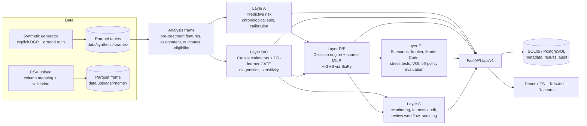

# Architecture & decision record

## 1. System overview

| Concern | Decision |
|---|---|
| Frontend | React 19 + TypeScript + Vite + Tailwind 4 + Recharts + lucide. A small in-house component kit (`components/ui.tsx`) instead of shadcn/ui (its CLI needs network scaffolding; the kit covers cards, tables, forms, modals, tabs). Light/dark theme through CSS variables; chart colours are the validated categorical palette from the dataviz skill. |
| Backend | FastAPI + Pydantic v2 request models, SQLAlchemy 2. Long work (data generation, model training) runs as background jobs (`/jobs/{id}` with progress). Interactive work (estimates, optimisation, scenarios) is synchronous (1-30 s). |
| Database | **SQLite by default** (nothing to install; PostgreSQL and Docker were not available in the build environment), **PostgreSQL via `CAUSALX_DATABASE_URL`**. The schema uses only portable types. SQLite differences are documented: it does not enforce column types, serialises writers, and needs `PRAGMA foreign_keys=ON` (set on connect). The PostgreSQL path has *not* been exercised in this build. |
| Bulk data | The six analytic tables (customers, loans, repayments, interventions, outcomes, economic indicators) plus the separate ground-truth table are stored as **Parquet files per dataset version** with a SHA-256 fingerprint in `manifest.json`. The relational DB holds datasets/versions, reports, models, estimates, runs, allocations, recommendations, reviews, audit log, snapshots. Rationale: columnar analytic scans, reproducibility via fingerprints, no giant arbitrary JSON columns. This deviates from "customers/loans/... as DB tables"; the metadata tables referencing them follow the requested schema. |
| Migrations | `Base.metadata.create_all` creates the schema. Alembic is not wired in this version (documented gap). |
| Causal inference | Own, small, tested implementation (`causal/estimators.py`): difference in means, regression adjustment, IPW (Hajek), cross-fitted AIPW; DR-learner (cross-fitted) + T-learner for CATE. EconML/DoWhy were evaluated but not used: they add a heavy, version-sensitive dependency stack and hide the details (clipping, trimming, cross-fitting, intervals) that this product wants to show. |
| Optimisation | `scipy.optimize.milp` (HiGHS) on a sparse constraint matrix with variables only for *eligible, available, filter-passing* pairs; LP relaxation duals for shadow prices; documented greedy heuristics as baselines. CVXPY/OR-Tools not needed. |
| Explainability | SHAP (TreeExplainer) for the risk model only, labelled predictive. Causal and optimisation explanations are separate structures. |
| Experiment tracking | Every causal run, optimisation run, scenario set, experiment and recommendation stores its configuration, versions and hashes in the DB (MLflow judged unnecessary: the registry tables + manifest hash cover the requirement without another service). |
| Security | Single local user, no authentication (documented). Upload limit and extension check, parameterised ORM queries, dataset/report names validated and resolved inside their directories, no secrets in source, error handler hides internals, destructive deletes require `confirm=true`. Not a security review. |

## 2. Data-role separation (anti-leakage design)

| Role | Cohorts (months) | Used for |
|---|---|---|
| Training | 0-7 | risk model fit, CATE fit, nuisance models for policy evaluation, propensity for uplift evaluation |
| Validation | 8-9 | model selection (Brier), threshold choice, calibration choice |
| Final evaluation / decision | 10-11 | risk metrics, uplift (Qini) evaluation, optimisation, policy evaluation (optimisation sees *predictions*, evaluation sees logged *outcomes*) |

Ground truth (`ground_truth.parquet`) is only read by benchmark code paths and tests; a test asserts none of its columns reach the analysis frame or feature list.

## 3. Brainstorm: 20 additions, scored and ranked

Scores are 1-5 on each criterion (higher is better; *Misleading risk* is scored inversely so 5 = low risk). Total /30.

| # | Idea | Novelty | Business use | Stat. validity | Feasibility | Portfolio | Misleading risk | **Total** | Decision |
|---|---|---|---|---|---|---|---|---|---|
| 1 | Budget / capacity frontier with marginal value and saturation point | 3 | 5 | 5 | 5 | 4 | 5 | **27** | **Built** |
| 2 | Conservative (lower-confidence-bound) optimisation | 4 | 5 | 4 | 5 | 5 | 4 | **27** | **Built** |
| 3 | Optimiser's-curse simulation (claimed vs realised benefit) | 5 | 5 | 4 | 4 | 5 | 4 | **27** | **Built** |
| 4 | Synthetic ground-truth scorecard on three assignment regimes (randomised / confounded / hidden confounding) | 4 | 4 | 5 | 5 | 5 | 5 | **28** | **Built** |
| 5 | Placebo outcome + E-value sensitivity | 4 | 4 | 4 | 4 | 5 | 4 | **25** | **Built** |
| 6 | Off-policy (DR) policy evaluation vs ground truth | 4 | 5 | 4 | 4 | 5 | 4 | **26** | **Built** |
| 7 | Policy stress tests of fixed allocations | 3 | 5 | 4 | 5 | 4 | 5 | **26** | **Built** |
| 8 | Value of (perfect) information, labelled as an upper bound | 5 | 4 | 4 | 4 | 5 | 3 | **25** | **Built** (EVPI only; EVSI future) |
| 9 | Decision counterfactual explorer (all candidates, break-even ARR, "what would change it") | 3 | 5 | 5 | 5 | 4 | 5 | **27** | **Built** |
| 10 | "Naive-effect optimiser" baseline to price the cost of ignoring confounding | 4 | 4 | 5 | 5 | 4 | 5 | **27** | **Built** |
| 11 | Experiment manifest (config + data fingerprint + hash) | 3 | 4 | 5 | 5 | 4 | 5 | **26** | **Built** |
| 12 | Rule-based analyst assistant that only proposes a configuration | 3 | 3 | 5 | 5 | 3 | 5 | **24** | **Built** (small; no LLM) |
| 13 | Effect stability by period | 3 | 4 | 3 | 4 | 4 | 3 | **21** | **Built** (3 periods; flagged as indicative) |
| 14 | Empirical-Bayes shrinkage of CATEs (curbs winner's curse) | 4 | 4 | 4 | 4 | 4 | 4 | **24** | Future (quick win) |
| 15 | Distributionally robust / aggregate chance-constrained optimisation | 5 | 4 | 4 | 2 | 5 | 4 | **24** | Future |
| 16 | Causal DAG editor with expert-specified graph and adjustment-set check | 4 | 3 | 3 | 2 | 4 | 3 | **19** | Future (needs graph tooling; discovery deliberately excluded) |
| 17 | Dynamic / sequential policies with contact-fatigue | 5 | 5 | 3 | 1 | 5 | 2 | **21** | Future (needs panel data and dynamic treatment regimes theory) |
| 18 | Interference via household clusters | 4 | 4 | 3 | 2 | 4 | 3 | **20** | Documented; design effect in sample-size tool |
| 19 | Bandit-based adaptive experiment allocation (simulated) | 4 | 3 | 4 | 3 | 4 | 4 | **22** | Future (simulation-only) |
| 20 | Automated causal discovery | 3 | 2 | 1 | 3 | 3 | 1 | **13** | Rejected: identifies associations, invites false causal claims |

First release = ideas 1-13. See `BUILD_STATUS.md` for what is partial.
